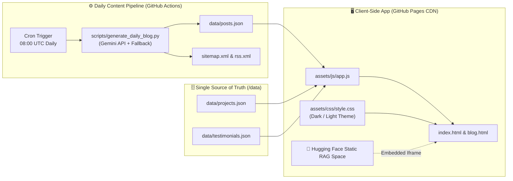

Website Link - https://akash12740.github.io

<div align="center">

<a href="https://akash12740.github.io">
  
</a>

<p align="center">
  <strong>Production-Grade, Modular & JSON-Driven AI/ML Engineering Portfolio, Interactive Math Lab & Automated Technical Blog</strong>
</p>

<p align="center">
  <a href="https://akash12740.github.io" target="_blank">
    
  </a>
  <a href="https://akash12740.github.io/blog.html" target="_blank">
    
  </a>
  <a href="https://huggingface.co/spaces/Akash12740/rag-document-qa-demo" target="_blank">
    
  </a>
  <a href="https://akash12740.github.io/capabilities.html" target="_blank">
    
  </a>
</p>

<p align="center">
  <a href="https://www.linkedin.com/in/akash-saini-83a42a1b1/" target="_blank">
    
  </a>
  <a href="https://topmate.io/akash12740/" target="_blank">
    
  </a>
  <a href="https://cal.com/akash-saini-12740/15min" target="_blank">
    
  </a>
  <a href="https://akashsaini12740.gumroad.com" target="_blank">
    
  </a>
  <a href="https://substack.com/@akashsaini12740" target="_blank">
    
  </a>
  <a href="https://akash12740.github.io/rss.xml" target="_blank">
    
  </a>
</p>

</div>

---

## 🌟 Overview & Live Links

Welcome to the source repository for **[https://akash12740.github.io](https://akash12740.github.io)** — a decoupled, modular, and self-updating AI/ML engineering platform built to bridge **graduate-level mathematical rigor (BITS Pilani)** with **production AI systems**.

| Destination | Direct URL | What You'll Find |
| :--- | :--- | :--- |
| **🏠 Main Portfolio** | **[akash12740.github.io](https://akash12740.github.io)** | 60-Second Executive Brief, Live AI Playgrounds, Math Lab, Playable Math Games, Benchmarks & Experience |
| **📚 Engineering Blog** | **[akash12740.github.io/blog.html](https://akash12740.github.io/blog.html)** | Searchable, topic-filtered articles on AI, ML, Data Science, Data Analytics & LLMs with BibTeX citations |
| **🤗 Live RAG Engine** | **[Hugging Face Space](https://huggingface.co/spaces/Akash12740/rag-document-qa-demo)** | Zero-latency interactive document Q&A with semantic chunking, cosine similarity gates & citations |
| **📄 Capabilities Sheet** | **[akash12740.github.io/capabilities.html](https://akash12740.github.io/capabilities.html)** | Printable 1-page consulting & AI/ML engineering capabilities deck |
| **📡 RSS Syndication** | **[akash12740.github.io/rss.xml](https://akash12740.github.io/rss.xml)** | Auto-updated XML feed for Substack, LinkedIn automation & RSS readers |

---

## 🏗️ Decoupled System Architecture

Unlike static portfolios that require rewriting HTML/CSS for every update, this platform separates **presentation**, **logic**, and **content**:



```text
```

```text
akash12740.github.io/
├── .github/
│   └── workflows/
│       └── daily-blog.yml        # Automated daily cron workflow (08:00 UTC)
├── scripts/
│   └── generate_daily_blog.py    # Generates new posts & updates posts.json, sitemap.xml & rss.xml
├── data/
│   ├── posts.json                # Single source of truth for homepage & blog.html articles
│   ├── projects.json             # Single source of truth for project cards & architecture modals
│   └── testimonials.json         # Single source of truth for collaborator & mentee endorsements
├── assets/
│   ├── css/
│   │   └── style.css             # Responsive glassmorphism UI with Dark / Light theme variables
│   └── js/
│       └── app.js                # Dynamic JSON renderer, BibTeX generator, Math Lab & Mini-Games
├── index.html                    # Main portfolio & interactive labs
├── blog.html                     # Searchable, filterable technical blog archive with quick TOC
├── capabilities.html             # Printable 1-page AI/ML consulting & capabilities deck
├── 404.html                      # Custom branded FAISS-themed 404 error page
├── rss.xml                       # Auto-generated RSS 2.0 syndication feed
├── sitemap.xml                   # Auto-updated XML sitemap for search engine indexing
├── robots.txt                    # Crawler directives
├── IMG_Akash_Saini.jpg           # Profile portrait
└── resume_AkashSaini.pdf         # Curriculum Vitae


🤝 Connect & Collaborate
🌐 Live Website: https://akash12740.github.io

💼 LinkedIn: linkedin.com/in/akash-saini-83a42a1b1

🎯 1:1 Mentorship & Mock Interviews: topmate.io/akash12740

📅 15-Min AI/ML Consulting Call: cal.com/akash-saini-12740/15min

📦 RAG & Math Starter Kits: akashsaini12740.gumroad.com

✉️ Email: aksainibits@gmail.com

Built with mathematical rigor by Akash Saini • Integrated M.Sc. Mathematics, BITS Pilani
